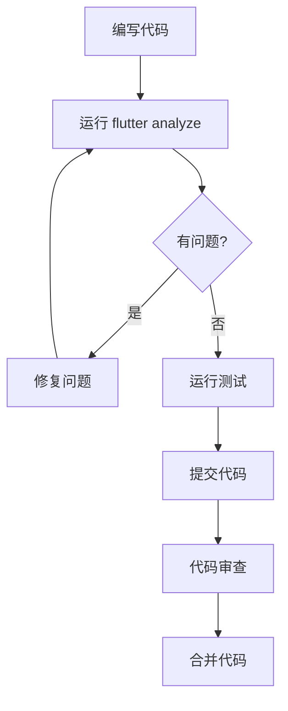

# 代码质量管理指南

本指南基于项目全局规则第10章「代码复杂度管理」和第13章「代码质量检测与持续优化」，为Langwise项目提供完整的代码质量管理方案。

## 📊 代码复杂度标准

### 量化指标

| 指标 | 标准值 | 检测方式 | 工具支持 |
|------|--------|----------|----------|
| **圈复杂度** | ≤ 8 | 静态分析 | `flutter analyze` |
| **函数长度** | ≤ 15行 | 代码审查 + 脚本扫描 | `code_quality_check.sh` |
| **参数数量** | ≤ 3个 | 代码审查 + Lint规则 | `analysis_options.yaml` |
| **嵌套深度** | ≤ 3层 | 代码审查 + 脚本扫描 | `prefer_early_return` |
| **类长度** | ≤ 300行 | 代码审查 | IDE显示 |

### 降低复杂度的方法

1. **单一职责原则**: 每个方法只做一件事
2. **减少嵌套**: 使用早期返回、卫语句
3. **函数拆分**: 将复杂函数拆分为多个小函数
4. **参数优化**: 使用配置对象、建造者模式
5. **设计模式**: 策略、状态机、责任链、建造者模式

## 🛠️ 工具配置

### 1. 静态分析配置

**文件**: `analysis_options.yaml`

```yaml
# 已配置的关键规则
cyclomatic_complexity: true          # 圈复杂度检测
prefer_early_return: true            # 优先早期返回
avoid_nested_conditional_expressions: true  # 避免嵌套条件
avoid_positional_boolean_parameters: true   # 避免位置布尔参数
```

**使用方法**:
```bash
# 运行静态分析
flutter analyze

# 检查特定文件
flutter analyze lib/specific_file.dart
```

### 2. 自动化质量检查

**文件**: `scripts/code_quality_check.sh`

**功能**:
- Dart分析器检查
- 代码格式检查
- 测试覆盖率检查
- 复杂度问题扫描
- 依赖和安全检查
- 生成质量报告

**使用方法**:
```bash
# 运行完整的代码质量检查
./scripts/code_quality_check.sh

# 查看生成的质量报告
open code_quality_report_*.md
```

### 3. 代码审查清单

**文件**: `docs/code_review_checklist.md`

**用途**: 代码审查时的检查清单，确保代码质量标准

## 🎯 设计模式应用

### 策略模式 - 替代复杂if-else

**问题**: 复杂的条件分支逻辑
```dart
// ❌ 复杂的if-else（圈复杂度高）
String processData(String type, String data) {
  if (type == 'json') {
    // JSON处理逻辑
  } else if (type == 'xml') {
    // XML处理逻辑
  } else if (type == 'csv') {
    // CSV处理逻辑
  }
  // ...
}
```

**解决方案**: 策略模式
```dart
// ✅ 策略模式（圈复杂度低）
abstract class DataProcessor {
  String process(String data);
}

class JsonProcessor implements DataProcessor {
  @override
  String process(String data) {
    // JSON处理逻辑
  }
}

class ProcessorFactory {
  static DataProcessor getProcessor(String type) {
    return _processors[type] ?? DefaultProcessor();
  }
}
```

### 建造者模式 - 减少参数数量

**问题**: 构造函数参数过多
```dart
// ❌ 参数过多（>3个）
class ApiRequest {
  ApiRequest(this.url, this.method, this.headers, 
            this.body, this.timeout, this.retries);
}
```

**解决方案**: 建造者模式
```dart
// ✅ 建造者模式
class ApiRequest {
  final String url;
  final String method;
  final Map<String, String> headers;
  final String? body;
  final Duration timeout;
  final int retries;
  
  ApiRequest._builder(ApiRequestBuilder builder)
    : url = builder.url,
      method = builder.method,
      headers = builder.headers,
      body = builder.body,
      timeout = builder.timeout,
      retries = builder.retries;
}

class ApiRequestBuilder {
  String url = '';
  String method = 'GET';
  Map<String, String> headers = {};
  String? body;
  Duration timeout = Duration(seconds: 30);
  int retries = 3;
  
  ApiRequestBuilder setUrl(String url) {
    this.url = url;
    return this;
  }
  
  ApiRequest build() => ApiRequest._builder(this);
}

// 使用
final request = ApiRequestBuilder()
  .setUrl('https://api.example.com')
  .setMethod('POST')
  .setBody(jsonData)
  .build();
```

## 📈 持续改进流程

### 1. 日常开发流程



### 2. 定期质量检查

- **每日**: 开发者运行 `flutter analyze`
- **每周**: 运行 `./scripts/code_quality_check.sh`
- **每月**: 团队代码质量回顾会议
- **每季度**: 重构计划制定和执行

### 3. 重构优先级

#### 🔴 高优先级（立即处理）
- 圈复杂度 > 10
- 函数长度 > 20行
- 嵌套深度 > 4层
- 安全漏洞
- 测试失败

#### 🟡 中优先级（本周处理）
- 参数数量 > 5个
- 类长度 > 500行
- 重复代码块
- 性能问题
- 测试覆盖率 < 80%

#### 🟢 低优先级（有时间时处理）
- 命名优化
- 注释完善
- 代码格式调整
- 小的重构机会

## 🔧 IDE配置建议

### VS Code配置

**文件**: `.vscode/settings.json`
```json
{
  "dart.lineLength": 80,
  "dart.showLintNames": true,
  "dart.analysisExcludedFolders": [
    "build",
    ".dart_tool"
  ],
  "editor.rulers": [80],
  "editor.formatOnSave": true
}
```

### Android Studio配置

1. 启用 Dart Analysis
2. 设置代码格式化快捷键
3. 配置 Lint 规则显示
4. 启用代码复杂度提示

## 📚 学习资源

### 设计模式
- [重构大师 - 设计模式目录](https://refactoringguru.cn/design-patterns/catalog)
- [Flutter设计模式实践](https://flutter.dev/docs/development/best-practices)

### 代码质量
- [Effective Dart](https://dart.dev/guides/language/effective-dart)
- [Flutter最佳实践](https://flutter.dev/docs/development/best-practices)
- [Clean Code原则](https://clean-code-developer.com/)

### 重构技巧
- [重构：改善既有代码的设计](https://refactoring.com/)
- [代码整洁之道](https://www.amazon.com/Clean-Code-Handbook-Software-Craftsmanship/dp/0132350884)

## 🎯 团队协作

### 代码审查流程

1. **提交前自检**
   - 运行 `flutter analyze`
   - 运行 `flutter test`
   - 检查代码复杂度

2. **创建Pull Request**
   - 填写详细的PR描述
   - 标注复杂度变更
   - 运行CI检查

3. **代码审查**
   - 使用 `docs/code_review_checklist.md`
   - 关注复杂度指标
   - 提供建设性反馈

4. **合并后跟踪**
   - 监控代码质量趋势
   - 记录重构经验
   - 更新最佳实践

### 团队规范

- **命名约定**: 遵循项目全局规则第2章
- **文件组织**: 遵循项目全局规则第1章
- **设计原则**: 遵循SOLID原则
- **测试要求**: 覆盖率 ≥ 80%

## 🚀 快速开始

1. **检查当前代码质量**
   ```bash
   ./scripts/code_quality_check.sh
   ```

2. **修复发现的问题**
   ```bash
   flutter analyze
   dart format .
   ```

3. **运行测试**
   ```bash
   flutter test --coverage
   ```

4. **查看覆盖率报告**
   ```bash
   open coverage/html/index.html
   ```

5. **提交代码前最后检查**
   ```bash
   flutter analyze && flutter test && dart format --set-exit-if-changed .
   ```

---

**记住**: 代码质量是一个持续改进的过程。每一次小的改进都会积累成显著的质量提升！

有问题或建议？请查看 [代码审查检查清单](code_review_checklist.md) 或联系团队负责人。