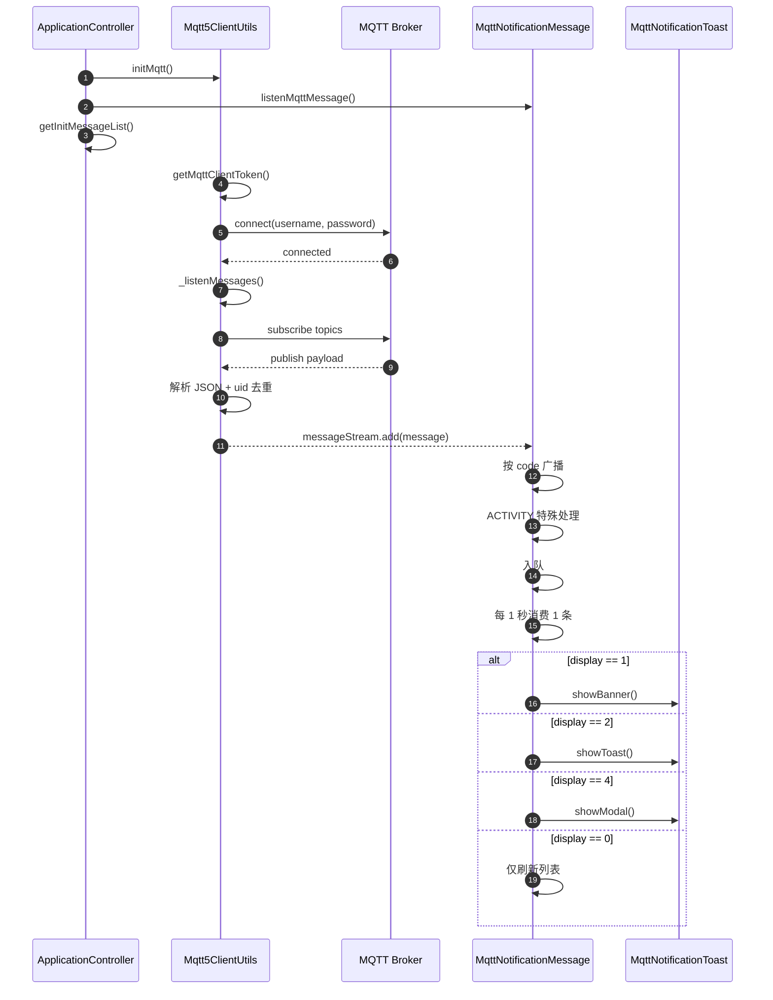

# MQTT 消息流程文档

## 1. 文档目的

本文档用于说明 `lib/utils/mqtt_utils` 目录下 MQTT 消息链路的当前实现流程，覆盖以下内容：

- MQTT 连接建立与重连流程
- 消息接收、解析、去重与分发流程
- 业务特殊处理流程
- 通知展示与点击交互流程
- 路由黑名单暂停与恢复机制
- 初始化拉取消息与 MQTT 实时消息的协作方式

本文档基于当前代码实现整理，适合作为联调、排查问题、补充测试用例的参考。

## 2. 核心角色

| 组件 | 文件 | 职责 |
| --- | --- | --- |
| MQTT 连接管理 | `mqtt5_client_utils.dart` | 获取 token、建连、订阅 topic、收消息、去重、重连、心跳监控 |
| 消息分发中心 | `mqtt_notification_message.dart` | 监听消息流、业务预处理、入队、节流弹出、列表刷新、展示分发 |
| 业务特殊处理 | `mqtt_message_business_processing.dart` | 处理 `ACTIVITY` 模块消息，如任务刷新、奖励提示 |
| 通知 UI | `mqtt_notification_toast.dart` | Banner、Modal 的展示，以及点击后的读消息、跳转、回调 |
| 消息实体 | `push_message_entity.dart` | 统一消息字段定义，约束展示方式与点击操作 |

## 3. 关键字段说明

### 3.1 PushMessageEntity

| 字段 | 含义 | 当前用途 |
| --- | --- | --- |
| `uid` | 消息唯一标识 | MQTT 收包去重、已展示上报、已读上报 |
| `display` | 展示方式 | `0` 红点、`1` Banner、`2` Toast、`4` Modal |
| `displayOperate` | 点击后的操作方式 | 控制 Banner 点击是跳转、弹窗、关闭还是直接进入 |
| `title` | 标题 | Banner、Toast、Modal 展示 |
| `content` | 内容 | Banner 副标题、Modal 正文 |
| `jump` | 跳转参数 | 点击消息后通过 `JumpPageUtils.jumpPage` 使用 |
| `category` | 分类 | 区分管理端消息与用户端消息，也影响跳转逻辑 |
| `module` | 模块 | 当前会对 `ACTIVITY` 走额外业务处理 |
| `code` | 业务 code | 供 `listenByCode` 做精确监听 |
| `read` | 已读状态 | 点击消息时决定是否调用已读接口 |
| `report` | 是否需要上报“已展示” | 初始化列表和手动注入消息会用到 |

### 3.2 display 与 displayOperate

#### display

| 值 | 含义 | 实际表现 |
| --- | --- | --- |
| `0` | 只有红点 | 不弹 UI，仅刷新消息列表并上报已展示 |
| `1` | 顶部 Banner | 右上角横幅通知 |
| `2` | Toast | 仅显示标题文本 toast |
| `4` | Modal | 弹出居中模态框 |

#### displayOperate

该字段主要影响 Banner 点击后的行为：

| 值 | 含义 | 行为 |
| --- | --- | --- |
| `null` / `0` | 按 `jump` 决定 | `jump != null` 直接跳转，否则弹默认 Modal |
| `1` | 一定弹 Modal | 如果有 `jump`，Modal 内展示“去查看”按钮 |
| `2` | 尽量直接跳转 | `jump != null` 则直接跳转，否则仅关闭 Banner |
| `3` | 直接关闭 | 不做跳转和弹窗 |

## 4. 总体时序

## 5. 启动与初始化流程

### 5.1 入口

应用初始化时，如果用户已登录，会同时启动以下三件事：

1. 调用 `Mqtt5ClientUtils.instance.initMqtt()` 建立 MQTT 长连接。
2. 调用 `MqttNotificationMessage.instance.listenMqttMessage()` 开始监听消息流。
3. 调用消息列表初始化接口 `getInitMessageList()` 拉取当前未处理消息。

这意味着当前消息系统采用的是“初始化拉取 + 长连接实时推送”并行模型。

### 5.2 路由观察器注册

`MqttNotificationMessage` 继承自 `GetObserver`，并作为 `navigatorObservers` 注册到应用根部。

它的主要作用是：

- 感知页面 `push/pop`
- 在命中黑名单页面时暂停弹消息
- 离开黑名单页面后恢复队列消费

## 6. MQTT 建连流程

### 6.1 获取连接凭证

`initMqtt()` 的前置条件：

- 用户已登录
- 当前不在连接中
- 当前还未连接成功

满足条件后会调用 `AccountUtil.getMqttClientToken()` 获取：

- `host`
- `port`
- `clientId`
- `username`
- `password`
- `groups`

随后校验 token 是否完整。当前至少要求以下字段有效：

- `host`
- `clientId`
- `username`
- `password`

### 6.2 创建客户端并连接

成功拿到 token 后，流程如下：

1. 先关闭旧客户端和旧订阅监听，避免重复收消息。
2. 创建 `MqttServerClient`。
3. 配置连接参数：
   - `keepAlivePeriod = 30`
   - `autoReconnect = false`
   - `resubscribeOnAutoReconnect = false`
4. 注册连接回调：
   - `onConnected`
   - `onDisconnected`
   - `onSubscribed`
5. 调用 `client.connect(username, password)` 发起连接。

### 6.3 连接成功后的动作

连接成功后会立即执行：

1. `_listenMessages()` 开始监听 broker 推送。
2. `_subscribeTopics()` 订阅当前用户关心的 topic。

`_onConnected()` 还会执行：

- 取消待执行重连定时器
- 启动心跳监控定时器
- 重置重连次数
- 标记当前不是手动断开

## 7. Topic 订阅流程

### 7.1 当前订阅范围

当前 `_buildTopics()` 会按环境与用户名拼出用户私有 topic：

`langwise/{env}/user/{username}/{module}`

当前启用的模块包括：

- `user_center`
- `learning`
- `activity`
- `system`
- `manage`
- `task`
- `reward`
- `other`

### 7.2 当前实现注意点

虽然 token 中包含 `groups`，但当前代码里的群组 topic 和广播 topic 逻辑仍处于注释状态，当前实际只订阅“用户私有 topic”。

因此当前流程文档需要按“已实现逻辑”理解，而不是按旧设计稿中的完整订阅模型理解。

## 8. 收包与解析流程

### 8.1 收到消息后的处理步骤

`_listenMessages()` 收到 broker 消息后，处理顺序如下：

1. 取 `publishMessage.payload`
2. 将字节流转成字符串
3. 判断是否是 retained 消息
4. 解析 JSON
5. 打印日志
6. 如果是 retained 消息，直接忽略业务处理
7. 如果携带 topic，则主动往同一 topic 发送空 retained 消息，尝试清理 retained 状态
8. 将 JSON 转成 `PushMessageEntity`
9. 基于 `uid` 做本地幂等去重
10. 写入 `_messageStreamController`

### 8.2 去重规则

当前通过 `_messageUidSet` 维护已经处理过的消息：

- 收到 MQTT 实时消息时，若 `uid` 已存在，则忽略
- 调用 `manualSetMessage()` 手动注入初始化消息时，若 `uid` 已存在，也会忽略

这保证了“初始化列表”和“实时推送”同时存在时，不会重复弹同一条消息。

### 8.3 retained 消息处理

当前实现对 retained 消息有两步动作：

1. 如果本次收到的是 retained 消息，直接 `return`
2. 同时会尝试用空 payload + `retain: true` 发布到原 topic，清理 retained

目的是避免客户端因 retained 消息重复收到旧通知。

## 9. 消息中心分发流程

### 9.1 监听入口

`MqttNotificationMessage.listenMqttMessage()` 订阅的是：

`Mqtt5ClientUtils.instance.messageStream`

每当收到一条 `PushMessageEntity`，会进入 `_messageProcessing()`。

### 9.2 _messageProcessing() 处理顺序

每条消息进入分发中心后，按以下顺序处理：

1. 先往 `_messageByCodeStreamController` 广播一份 `PushMessageServiceEnitiy`，且 `isBackPage = false`
2. 如果 `module == ACTIVITY`，则执行 `MqttMessageBusinessProcessing.activityMessageProcessing(data)`
3. 无论是否是活动消息，都会加入 `_messageQueue`
4. 如果当前已暂停，则只入队，不消费
5. 如果当前未暂停，则启动队列消费

### 9.3 按业务 code 监听

业务页面可以通过 `listenByCode()` 监听特定 `code` 的消息。

典型用途：

- 某个管理端页面等待后台任务完成通知
- 页面跳转回来后，继续接收“处理完成”的结果

支持两个模式：

- `whereBackPage = false`：只监听首次收到的消息
- `whereBackPage = true`：同时监听跳转返回后的回调消息

## 10. ACTIVITY 模块特殊处理流程

当消息 `module == ACTIVITY` 时，会额外进入 `MqttMessageBusinessProcessing.activityMessageProcessing()`。

处理规则如下：

1. 消息为空或模块不匹配时，直接返回。
2. 如果当前正在引导流程中，则只刷新远程任务后返回。
3. 读取 `category`。
4. 如果 `category == reward`，先弹一个奖励提示对话框。
5. 读取 `code` 作为任务标识。
6. 如果 `code` 为空，调用 `GuideManager.instance.pushMethod()`。
7. 如果 `code` 不为空，先 `loadRemoteTasks()`。
8. 在 `GuideManager.instance.tasks` 中查找匹配的任务。
9. 找到任务且未完成时，调用 `scheduleStartTask(task.taskId)`。

需要注意：

- 这个业务处理不会中断普通通知分发，活动消息仍然会继续进入队列。
- 因此同一条活动消息可能同时触发“任务系统动作”和“普通通知展示”。

## 11. 队列消费与节流流程

### 11.1 队列设计

`_messageQueue` 用于缓存待展示消息，`_messageTimer` 负责每秒消费 1 条。

设计目标：

- 多条消息到达时不要同时弹出
- 保持展示节奏稳定
- 在黑名单页面暂停 UI 干扰

### 11.2 启动消费条件

`_startDispatchMessage()` 只有在以下条件同时满足时才会启动：

- 当前没有暂停
- 队列非空
- 当前没有已启动的消费定时器

### 11.3 消费规则

定时器每 1 秒执行一次：

1. 如果已经暂停，停止消费
2. 如果队列为空，停止消费
3. 否则从队列头部取出一条消息
4. 调用 `_dispatchMessage(entity)` 分发展示
5. 如果本次消费后队列为空，则停止定时器

## 12. 展示分发流程

### 12.1 _dispatchMessage() 的公共动作

无论最终展示形式如何，当前都会先做两件事：

1. `reportAlready([entity])`
2. `refreshMessageList(entity)`

说明如下：

- `reportAlready()` 会把需要上报的 `uid` 发送给服务端，表示消息已经展示过
- `refreshMessageList()` 会尝试刷新用户端和管理端消息列表

### 12.2 display 分支

#### display = 0

- 不弹任何 UI
- 仅执行“已展示上报 + 刷新消息列表”

#### display = 1

- 调用 `showBanner(entity)`
- 展示右上角横幅通知

#### display = 2

- 调用 `showToast(entity)`
- 当前只使用 `title` 展示轻提示
- 如果 `title == null`，则不会显示 toast

#### display = 4

- 调用 `showModal([entity])`
- 展示居中模态框

## 13. Banner 点击交互流程

Banner 点击逻辑定义在 `NotificationToastWidget.checkNotification()`。

### 13.1 通用前置逻辑

点击 Banner 后先做以下处理：

1. 如果新手引导正在进行中，直接禁止点击
2. 如果已经点击过一次，则忽略重复点击
3. 调用 `readMessage()` 尝试将消息标记为已读

### 13.2 已读处理

`readMessage()` 会根据消息分类决定走哪个控制器：

- 管理端消息：优先走 `ManageMessageController.readMessage()`，如果控制器未注册则直接调接口
- 用户端消息：如果 `MessageController` 已注册，则调用 `MessageController.readMessage()`

### 13.3 displayOperate 分支

#### displayOperate = null / 0

- `jump != null`：关闭 Banner，直接跳转页面
- `jump == null`：关闭 Banner，弹默认 Modal

#### displayOperate = 1

- 一定弹 Modal
- 如果 `jump != null`，则在 Modal 中显示“去查看”按钮

#### displayOperate = 2

- `jump != null`：关闭 Banner，直接跳转页面
- `jump == null`：仅关闭 Banner，不再补弹 Modal

#### displayOperate = 3

- 直接关闭 Banner

### 13.4 页面返回回调

如果 Banner 跳转到了其他页面，页面返回时会通过 `onPageBack` 回调，把结果重新包装成：

- `message`
- `isBackPage = true`
- `backPageResult`

然后重新推送到 `_messageByCodeStreamController`，供业务侧通过 `listenByCode(whereBackPage: true)` 继续处理。

## 14. Modal 展示流程

### 14.1 单条消息

当传入消息数为 1 条时，直接展示单个居中弹窗。

### 14.2 多条消息

当传入多条消息时，使用 `CarouselSlider` 横向切换展示。

### 14.3 Modal 按钮规则

- `jump == null`：展示“确定”按钮，仅关闭弹窗
- `jump != null`：展示“取消”和“去查看”按钮
- 点击“去查看”后会调用 `JumpPageUtils.jumpPage(message)`，并支持 `onPageBack` 回调

## 15. 初始化消息与实时消息协作流程

当前初始化拉取列表的处理方式如下：

1. 获取消息列表
2. 更新未读数
3. 对拉到的消息执行 `reportAlready(datas)`
4. 将 `display == 4` 的消息汇总成 `modalList`
5. 直接调用 `showModal(modalList)`
6. 将其他消息作为 `queueList` 交给 `Mqtt5ClientUtils.manualSetMessage(queueList)`

### 15.1 为什么要走 manualSetMessage()

这是为了复用 MQTT 的去重逻辑和消息流分发逻辑：

- 初始化拉取到的普通消息，会像实时消息一样进入 `messageStream`
- 最终仍由 `MqttNotificationMessage` 按统一规则入队和展示
- 如果实时推送已经先到过，同 `uid` 的初始化消息会被过滤掉

## 16. 黑名单页面暂停流程

### 16.1 黑名单页面

当前黑名单路由包括：

- `Routes.PRACTICE_QUESTIONS`
- `Routes.PRACTICE_QUESTIONS_EVAL`
- `Routes.PRACTICE_QUESTIONS_REVIEW`

### 16.2 进入黑名单页面

当页面 `push` 到黑名单路由时：

1. `_isPaused = true`
2. 停止消费定时器
3. 后续消息继续进队列，但不弹出

### 16.3 离开黑名单页面

当页面 `pop` 回非黑名单路由，或新页面进入非黑名单路由时：

1. `_isPaused = false`
2. 重新调用 `_startDispatchMessage()`
3. 队列中的消息恢复按每秒 1 条继续消费

## 17. 断连与重连流程

### 17.1 自动重连触发条件

以下场景会触发 `_scheduleReconnect()`：

- 初次连接失败
- 连接过程中抛异常
- 非手动断开的断连回调触发

### 17.2 自动重连保护条件

满足以下任一条件时，不会继续重连：

- 当前为手动断开
- 用户未登录
- 当前已经连接成功
- 当前已经处于连接流程中
- 已存在待执行重连定时器
- 已达到最大重连次数 `10`

### 17.3 手动断开

调用 `disconnect()` 后会：

1. 取消重连定时器
2. 重置重连次数
3. 标记为手动断开
4. 关闭客户端与订阅监听

手动断开后，`_onDisconnected()` 不会再触发自动重连。

## 18. 现状与注意事项

### 18.1 当前已实现的关键特性

- MQTT 消息按 `uid` 去重
- 初始化列表与实时推送共用一套分发逻辑
- 消息支持 Banner、Toast、Modal、多页面回调
- 黑名单页面支持暂停消息展示
- `ACTIVITY` 模块支持业务预处理

### 18.2 当前实现上的边界点

- `display == 0` 时不会展示 UI，只刷新列表与上报展示
- `showToast()` 依赖 `title`，标题为空时不会显示
- 当前只订阅用户私有 topic，群组与广播 topic 尚未启用
- `dispose()` 目前会取消消息监听和消费定时器，但未关闭 `_messageByCodeStreamController`
- 连接成功后的订阅依赖当前 token，若 token 失效，需要业务层重新初始化 MQTT

## 19. 建议的排查顺序

当出现“消息没弹出”问题时，建议按以下顺序排查：

1. 是否已登录并调用 `initMqtt()`
2. MQTT 是否连接成功，是否完成 topic 订阅
3. broker 是否真正把消息投递到当前用户 topic
4. payload 是否能正确解析成 `PushMessageEntity`
5. `uid` 是否因为重复被去重
6. 当前页面是否命中黑名单导致暂停
7. `display` 是否为 `0`
8. `title` 是否为空导致 Toast 不展示
9. `displayOperate` 是否导致点击后仅关闭而不跳转

