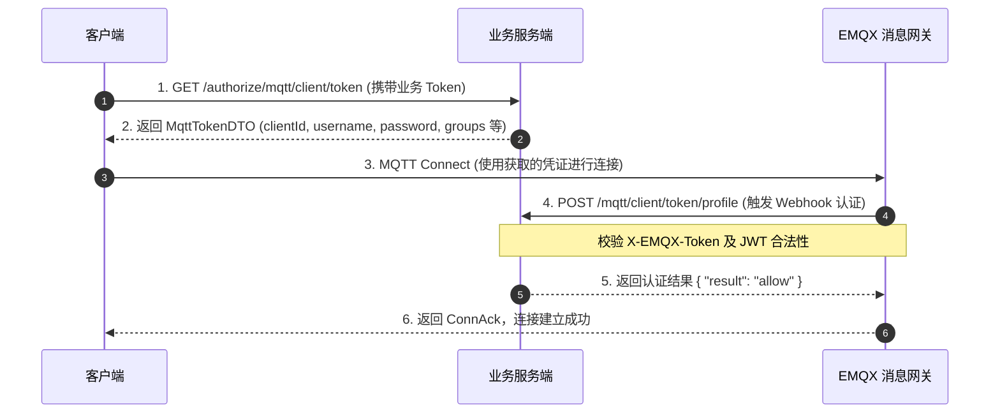
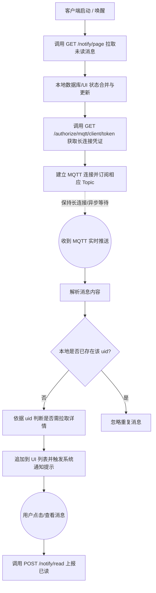

# 消息系统架构与设计文档

## 1. 概述

本系统是一个基于 WebSocket、MQTT 协议以及第三方推送（如 JPush）构建的混合消息推送与通知系统。
- **WebSocket / MQTT**: 主要处理端内的实时消息与状态同步，需要客户端进行严格的登录认证。
- **JPush (极光推送)**: 用于处理设备系统级别的离线消息唤醒（APNs/FCM 等），属于操作系统层面的推送，不需要在业务层进行 WebSocket/MQTT 的长连接登录认证。

通过 HTTP 接口进行历史消息拉取，并结合长连接网关（如 EMQX）进行实时消息投递，以满足单聊、群组广播和全站系统通知等多种业务场景。

---

## 2. 认证与登录流程

消息系统的建立需要保证通道的安全性。客户端在连接底层长连接网关前，必须先通过业务服务端获取合法的访问凭证。

### 2.1 凭证获取接口

系统提供了统一的认证层，支持 WebSocket 和 MQTT 两种协议的 Token 下发：
- **WebSocket**: 客户端请求 `GET /authorize/websocket/client/token` 获取 WebSocket 专属的 `WebSocketTokenDTO`。
- **MQTT**: 客户端请求 `GET /authorize/mqtt/client/token` 获取包含 MQTT 连接信息的 `MqttTokenDTO`。
  - 下发的凭证通常包含：`clientId` (如 `lang:{userId}:{设备标识}`)、`username` (通常为 `userId`)、`password` (基于 JWT 生成的动态 Token)、服务器 `host`/`port`，以及**当前用户所属的群组列表 `private List<String> groups;`**。

### 2.2 EMQX 认证回调拦截

为了验证 MQTT 客户端的合法性，系统集成了 EMQX 的 Webhook 认证机制。
- 当客户端尝试连接 EMQX 时，EMQX 会向业务服务端发起 `POST /authorize/mqtt/client/token/profile` 请求。
- 服务端通过校验请求头中的 `X-EMQX-Token`（确保是受信任的网关发来的请求），并进一步校验 payload 中的 `password` (JWT) 以及 `username` 和 `clientId` 的匹配关系。
- 校验通过则返回 `{ "result": "allow" }`，否则返回 `{ "result": "deny" }`。

### 2.3 认证流程图

---

## 3. MQTT 订阅规则与安全限制 (ACL)

为了保证系统的安全性与带宽效率，针对客户端连接有严格的权限限制和数据精简策略。

### 3.1 客户端 Topic 订阅白名单

客户端**仅允许订阅 (Subscribe)** 以下指定规则的 Topic，**严禁向任何 Topic 发布 (Publish)** 消息（客户端仅作为消息接收端）：
- **个人消息**: `langwise/dev/user/${username}/+`
- **群组消息**: `langwise/dev/group/${group}/+` (其中 `${group}` 来自登录时下发的 `groups` 列表)
- **全局广播**: `langwise/dev/user/broadcast/+`

*注意：客户端若尝试执行 Publish 或订阅未授权的 Topic，将被网关拒绝并可能直接断开连接。*

### 3.2 ⚠️ 核心注意：MQTT 消息载荷精简设计

**重点提示**：为了节省高频群聊和广播场景下的网络带宽成本，避免大体积数据的浪费，系统在 MQTT 消息推送上进行了**数据裁剪**。
服务端在通过 MQTT 下发消息时，**会主动将 `content`（消息正文）和 `extra`（扩展数据）字段强制置为 `null`**。
MQTT 仅作为**事件触达**通道。客户端收到 MQTT 消息后，主要依据其中的 `uid` 等基础信息判断本地是否已有记录，缺失详情时应通过 HTTP `GET /notify/page` 接口拉取完整的消息内容。

---

## 4. MQTT Topic 路由设计

Topic 承担着消息精确路由的职责。系统采用了具有高度可读性和扩展性的层级 Topic 结构。
根据 `Notification` 对象中的属性，动态构建目标 Topic：

1. **个人消息 (Type = 1 或 null)**
   - **规则**: 将消息路由到特定用户。
   - **说明**: 客户端匹配订阅 `langwise/dev/user/${username}/+`
2. **群组/广播消息 (Type = 2)**
   - **规则**: 将消息路由到特定的群组或业务组。
   - **说明**: 客户端依据登录返回的 groups 列表，匹配订阅 `langwise/dev/group/${group}/+` 即可接收该群组消息。
3. **系统全局消息 (Type = 3)**
   - **规则**: 面向全站所有用户的系统级广播。
   - **说明**: 客户端匹配订阅 `langwise/dev/user/broadcast/+`

---

## 5. 消息协议与字段定义

客户端与服务端通过 JSON 格式传递消息载荷，消息结构主要由 `NotificationDTO` 定义：

| 字段名 | 类型 | 说明 | 业务场景 / 注意事项 |
| --- | --- | --- | --- |
| `uid` | `String` | **唯一消息ID** | **核心字段**。消息的全局唯一标识，客户端收到后**必须依靠此 ID 进行本地去重（幂等处理）**，避免通知栏重复弹窗。 |
| `display`| `Integer`| 显示提醒方式 | 指示前端该如何向用户展示提醒。取值: `0`: 只有红点, `1`: 顶部 Banner, `2`: Toast, `4`: 弹窗 Modal。 |
| `title` | `String` | 消息标题 | 消息的简短描述，常用于通知栏提醒或列表主标题。 |
| `content` | `String` | 消息内容 | 消息的具体正文详情。*(⚠️ MQTT 实时下发时强制为 `null`)* |
| `jump` | `JumpBo` | 跳转链接 | 包含点击消息后需要路由的目标页面标识或执行的特定动作参数。 |
| `category`| `Enum` | 消息分类 | `NotificationCategoryEnum`，区分系统、登录、推广、奖励等大类，便于前端做消息中心 Tab 分类。 |
| `module` | `Enum` | 模块类型 | `NotificationModuleEnum`，标识消息归属的具体业务模块（如商城、学习中心等）。 |
| `code` | `String` | 页面 Code | 指示此通知关联的特定页面标识。 |
| `extra` | `String` | 额外数据 | JSON 格式存储的透传扩展数据。*(⚠️ MQTT 实时下发时强制为 `null`)* |

---

## 6. 消息加载与启动同步机制

为了防止弱网掉线、离线期间的消息遗漏，系统采用了 **“推拉结合”** 的模型。

### 6.1 启动拉取与状态同步接口

在客户端（App / Web）每次启动或重连业务服务端时，必须优先拉取历史和离线消息。

**1. 拉取通知列表**
- **接口**: `GET /notify/page`
- **参数**: 
  - `status`: 消息状态（如 0: 未读, 1: 已读）。
  - `PageParam`: 分页参数（页码、条数）。
- **返回**: `HttpResult<SimplePage<NotificationDTO>>`

**2. 消息已读上报**
当客户端通过 `GET /notify/page` 拉取到消息，或者通过 MQTT 收到实时推送，并且用户在界面上查看/处理了该消息后，必须调用此接口向服务端同步已读状态。
- **接口**: `POST /notify/read`
- **参数**: `NotifyStatusRequest` (包含对应的消息 `uid` 或其他标识)
- **返回**: `HttpResult<String>` (成功返回 "OK")

### 6.2 推拉结合同步流程

---

## 8. 备注

### Token 续期机制未闭环
- **问题**: 下发的 MQTT 密码是 JWT 形式，具有过期时间。客户端保持长连接期间如果 JWT 过期，且 EMQX 配置了严格的心跳/鉴权校验，可能会导致连接断开。
- **建议**: 客户端需要建立 Token 过期刷新机制（RefreshToken），在 JWT 快要过期时主动通过 API 换取新 Token，并利用新 Token 重新建立 MQTT 连接或进行平滑重连。
